# Campus Equipment Booking and Loan System

*A software lab team project on fair, accountable sharing of university equipment.*

Departments in most universities own a good deal of equipment that students need only now and then: cameras and lenses in the media lab, laptops for fieldwork, oscilloscopes and multimeters in the electrical labs, projectors for presentations. In our experience this equipment is usually lent out through a paper register or a shared spreadsheet kept by whichever staff member happens to be on duty. That works while demand is low, but it breaks down quickly around project deadlines. Two students turn up for the same camera, nobody is sure who returned what in which condition, late returns go unnoticed, and the person who asked first (or simply asked loudest) gets the item.

This repository contains our answer to that problem: a web application through which students reserve and borrow equipment, lab staff approve requests and handle collections and returns, and administrators manage inventory, borrowing policies, fines and reports. The system is built around one central idea. When several students compete for the same item at the same time, the decision should not depend on who clicked first. It should depend on how responsibly each student has borrowed in the past, measured by a transparent credit score that students can inspect for themselves.

---

## Contents

1. [Objectives](#1-objectives)
2. [Users and their roles](#2-users-and-their-roles)
3. [A look at the application](#3-a-look-at-the-application)
4. [System architecture](#4-system-architecture)
5. [Data model](#5-data-model)
6. [Core workflows](#6-core-workflows)
7. [Business rules](#7-business-rules)
8. [Design patterns](#8-design-patterns)
9. [Data integrity and concurrency](#9-data-integrity-and-concurrency)
10. [Testing](#10-testing)
11. [Running the project](#11-running-the-project)
12. [API overview](#12-api-overview)
13. [Team and contributions](#13-team-and-contributions)
14. [Limitations and future work](#14-limitations-and-future-work)

---

## 1. Objectives

We set ourselves the following goals at the start of the project.

1. **Replace informal record keeping** with a single system in which every reservation, loan, return, fine and payment is recorded and can be traced back to the person who acted on it.
2. **Allocate contested equipment fairly.** Requests that overlap in time should be compared together and ranked by a borrowing score, rather than served first come, first served.
3. **Make the score explainable.** A student should be able to see exactly which factors make up their score and why it changed after each event.
4. **Enforce borrowing policy consistently**, including loan lengths, booking limits, grace periods, overdue fines and blocking rules, while still letting administrators adjust that policy per category of equipment.
5. **Keep the data correct under concurrent use.** Two staff members approving overlapping requests at the same moment must never result in a double booking.
6. **Build it the way real software is built:** a layered backend, a separate frontend, automated tests, containerised deployment and a pull request workflow within the team.

## 2. Users and their roles

The system has three kinds of users. Each one sees a different portal after signing in.

**Students** browse the equipment catalogue, check when an item is free, and submit a reservation request for a time slot. They can follow the request through approval, collection and return, ask for an extension on an active loan, pay fines online or record a payment made at the cash desk, and raise a dispute if they think a fine or a condition report is wrong. A dedicated page shows their credit score, the components behind it, and the full history of changes.

**Lab staff** are assigned to one or more locations (for example the CSE Hardware Lab) and only see equipment and requests for those locations. They work through the requests queue, hand over equipment at collection, inspect it on return, decide on extension requests and schedule maintenance. Certain sensitive actions require an additional permission that an administrator grants individually: verifying offline payments (`VERIFY_PAYMENTS`), approving out of rank order (`OVERRIDE_ALLOCATION`), granting exceptions to blocked students (`GRANT_EXCEPTIONS`), and charging for damage or loss (`ASSESS_CHARGES`).

**Administrators** manage users and roles, the inventory, categories and locations, borrowing policies and the credit scoring configuration. They can waive or correct fines, resolve disputes, read the audit log and generate reports on utilisation, overdue items, finances, incidents and overrides.

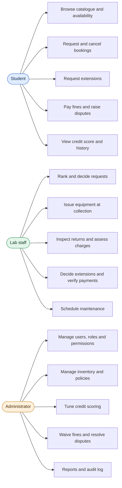

## 3. A look at the application

The screenshots below were taken against the demo data that the backend seeds on first start.

| Student dashboard | Credit score breakdown |
|---|---|
| 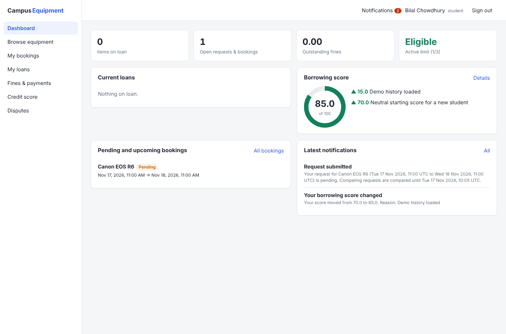 | 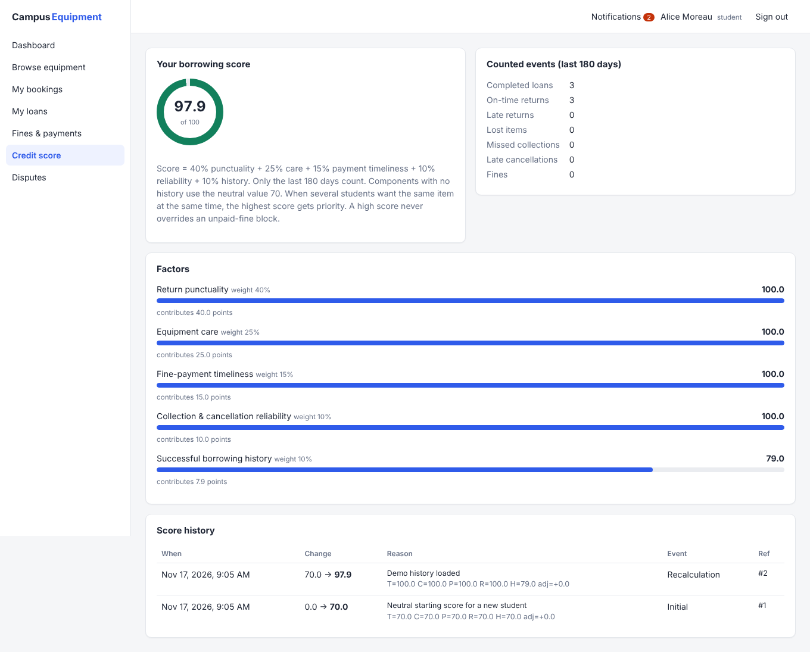 |
| **Staff requests queue** | **Administrator reports** |
| 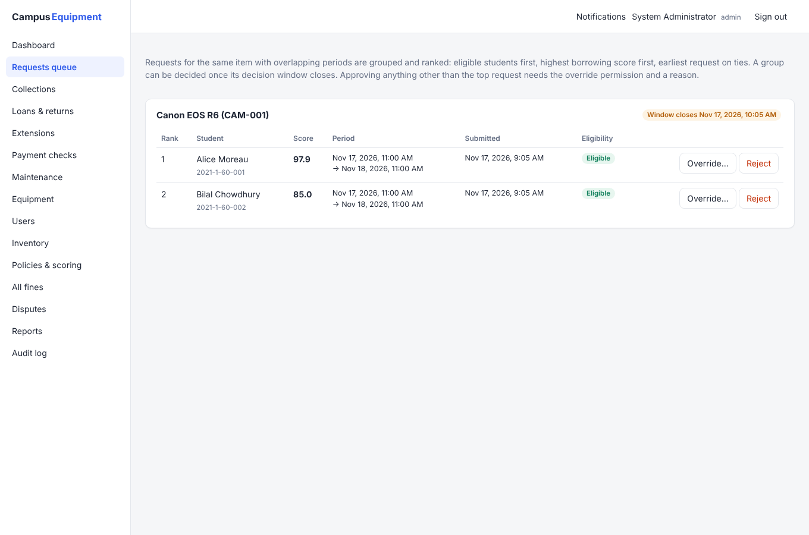 | 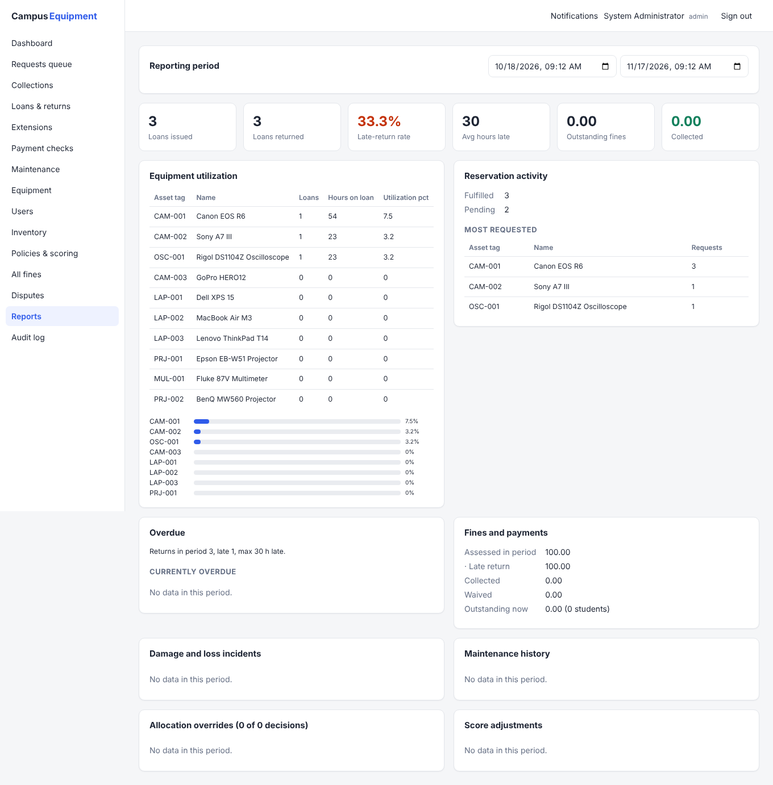 |

The requests queue is perhaps the clearest illustration of the project's purpose. Two students have asked for the same Canon camera for the same day. Instead of approving whichever request arrived first, the system groups them, ranks them by score (97.9 against 85.0), and holds the decision until a short decision window has closed so that requests made at nearly the same moment are compared fairly.

## 4. System architecture

The application follows a conventional three-tier structure. A React single-page application talks to a Spring Boot REST API, which stores its data in PostgreSQL. In the Docker setup the frontend is served by nginx, which also forwards `/api` calls to the backend so the browser only ever talks to a single origin.

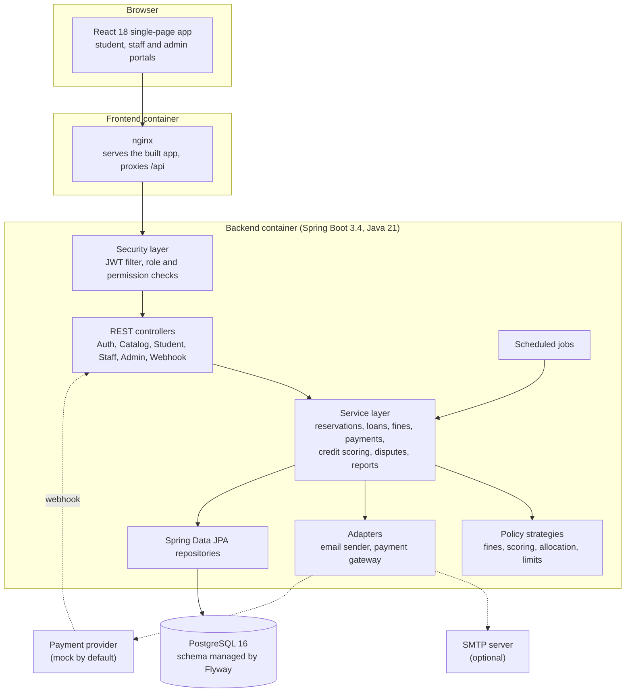

### Technology choices

| Layer | Technology | Why we chose it |
|---|---|---|
| Backend framework | Spring Boot 3.4 on Java 21 | Mature, well documented, and covered in our coursework. Gives us dependency injection, transactions and scheduling out of the box. |
| Persistence | Spring Data JPA, PostgreSQL 16, Flyway | PostgreSQL supports exclusion constraints, which we rely on to prevent double bookings. Flyway keeps the schema under version control. |
| Security | Spring Security, JWT (jjwt 0.12) | Stateless access tokens for the API, with short-lived access tokens and rotating refresh tokens. |
| API documentation | springdoc OpenAPI / Swagger UI | Lets the frontend developers explore and try the API without reading controller code. |
| Frontend | React 18, React Router 6, Vite 5 | Fast development server, simple component model, and an easy way to split the portals between team members. |
| Deployment | Docker and Docker Compose | One command starts the database, backend and frontend together on any machine. |

### Backend package structure

```
backend/src/main/java/edu/campus/equipment
├── config/      application properties, Clock bean, demo data seeder
├── security/    JWT service and filter, current-user helper, security rules
├── domain/      JPA entities and the state enums
├── repo/        Spring Data repositories
├── service/     business logic
│   ├── policy/  strategy implementations (fines, scoring, allocation, limits)
│   ├── payment/ payment gateway adapter and payment service
│   └── notify/  notification service and email adapters
└── web/         REST controllers, request and view DTOs, error handling
```

Controllers are deliberately thin. They validate input, resolve the current user and hand over to a service. All rules live in the service layer, which is what the integration tests exercise.

On the frontend, each portal is a self-contained module in `frontend/src/routes/` that exports its own pages, routes and sidebar entries. `App.jsx` and `Layout.jsx` simply read those modules. This made it possible for three people to work on the frontend in parallel without editing the same files.

## 5. Data model

The schema has around thirty tables. The diagram below shows the main entities and how they relate; join tables (staff locations, permissions, accessories, photos, payment targets) and a few audit columns are left out for readability.

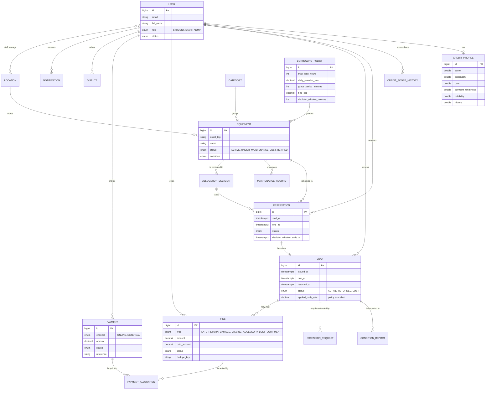

Two features of the model are worth pointing out. First, a reservation and a loan are separate entities. A reservation is an intention to borrow; it only becomes a loan when the student actually collects the item, which lets us tell apart students who book and never turn up from students who borrow and return late. Second, each loan copies the relevant policy values (rate, grace period, cap) at the moment it is issued. If an administrator later changes the policy, loans already in progress are not affected, which seemed to us the only fair way to handle policy changes.

## 6. Core workflows

### 6.1 Reservation lifecycle

Every reservation moves through a small, explicit state machine. A request starts as `PENDING`. Staff can approve it, reject it, or (if it lost to a higher ranked request) place it on the waitlist. An approved reservation becomes `FULFILLED` when the student collects the item, or `EXPIRED` if they never come. Any attempt to make a transition that is not drawn below is rejected by the backend with HTTP 409.

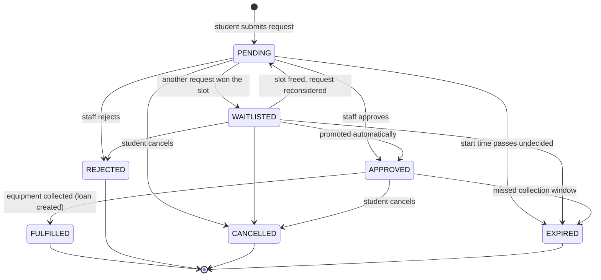

### 6.2 Loan lifecycle

The loan state machine is intentionally smaller. We considered storing "overdue" as a separate state but decided against it, because it is a fact that follows from the clock rather than from anything a person does. A loan is overdue simply when it is still `ACTIVE` and its due time has passed.

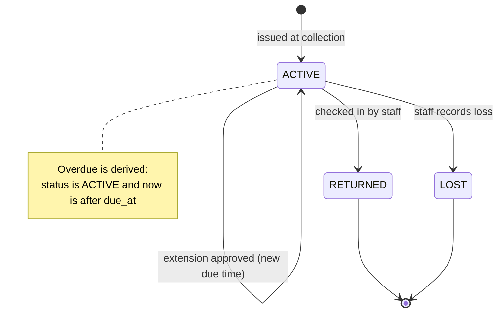

### 6.3 From request to return

The sequence diagram below follows one item through its full life, from the student's request to the moment the credit score is recalculated after the return.

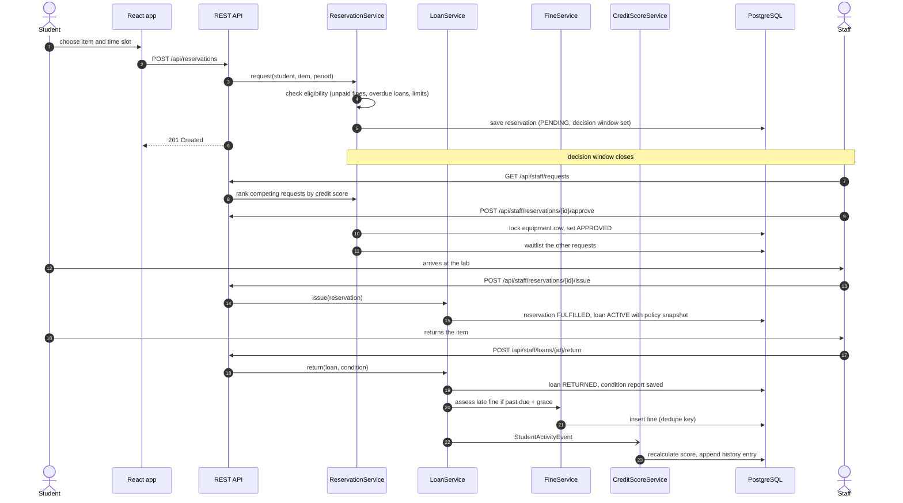

### 6.4 Allocating a contested item

When requests overlap, the decision is made by the following procedure. The decision window exists so that a request submitted at 9:05 and another submitted at 9:06 are compared on their merits rather than by a one-minute difference in arrival.

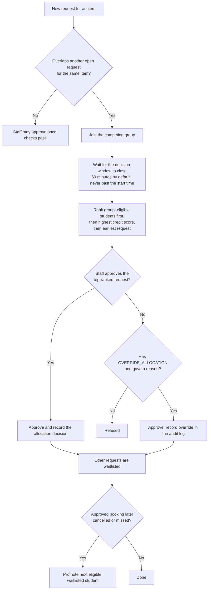

Students can see their own rank and the outcome, but never another student's score or identity. We felt this was important: the score is meant to encourage good behaviour, not to become a public league table.

## 7. Business rules

### 7.1 Credit score

The score is a weighted sum of five components, each on a scale of 0 to 100:

> **S = 0.40·T + 0.25·C + 0.15·P + 0.10·R + 0.10·H** (plus any manual adjustment, clamped to the range 0 to 100)

Only the recent history counts (the last 180 days by default), so a student who had a bad semester can recover. A component for which there is no evidence yet takes the neutral value of 70, which is also where every new student starts.

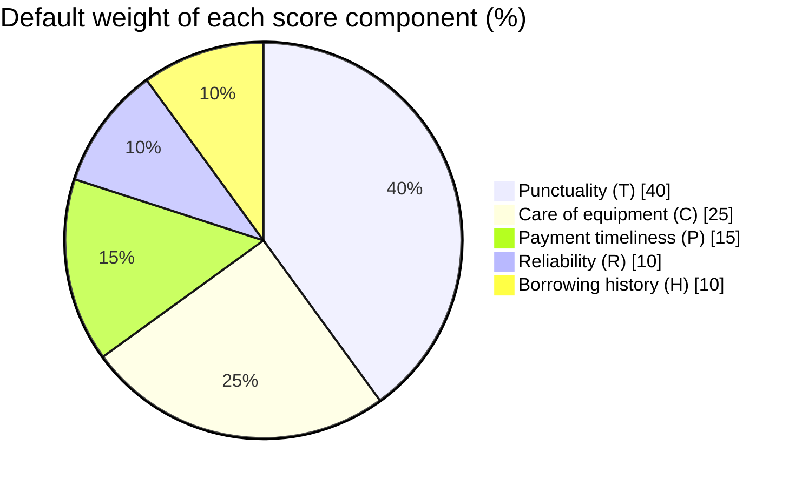

| Component | What it measures | How it is computed |
|---|---|---|
| T, punctuality | Returning on time | Per closed loan, 100 if returned within the due time plus grace period, minus 15 points for each started day late. A lost item scores 0. |
| C, care | Condition on return | 100 for normal condition or ordinary wear, 50 if accessories were missing, 0 for verified damage or loss. |
| P, payment | Paying fines promptly | 100 if a fine is settled within 7 days, then 5 points less per extra day. Unpaid fines older than 7 days score 0. A student with loans but no fines scores 100. |
| R, reliability | Collecting what was booked | 100 for a collected booking, 40 for a late cancellation, 0 for a missed collection. |
| H, history | Length of good track record | Rises from the neutral value towards 100 as the number of clean loans approaches 10. |

We gave punctuality the largest weight because late returns are what actually stop other students from getting equipment. Administrators can change all of these weights and parameters from the admin portal, and can add or void manual adjustments, always with a written reason that the student can see.

### 7.2 Overdue fines

The late fine is calculated with the formula

> **F = min(cap, rate × ⌈ max(0, t_return − t_due − grace) / 24h ⌉)**

In words: the grace period is forgiven, every started day after that is charged at the daily rate, and the total never exceeds the cap. The rate, grace period and cap come from the policy snapshot stored on the loan. The chart shows the result for the seeded "High-value instruments" policy (200 per day, capped at 2000).

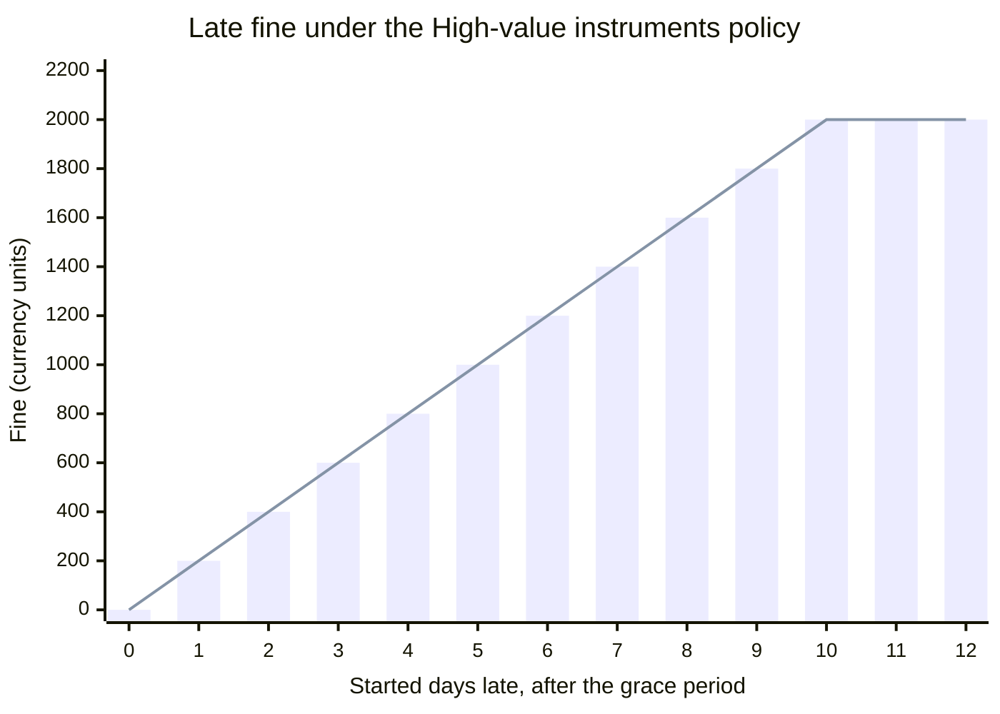

Besides late fines, staff with `ASSESS_CHARGES` can add charges for damage, missing accessories or loss, and administrators can waive or correct any fine with a reason.

### 7.3 Payments

Payments may be partial. Money is applied first to the fines the student selected and then to their oldest outstanding fines. There are two channels. An **online** payment goes through the payment gateway; in this project that is a mock gateway whose checkout calls our webhook to confirm the payment. An **external** payment (cash desk or bank transfer) is recorded by the student with a reference and only counts once a staff member with `VERIFY_PAYMENTS` has verified it.

### 7.4 Blocking rules and policy settings

Unpaid fines block a student from requesting, being approved, collecting and extending. Some further rules are policy decisions and can be configured per policy:

| Setting | Default | Effect |
|---|---|---|
| `disputedFinesBlock` | true | A fine under dispute still blocks borrowing until the dispute is resolved. |
| `overdueLoanBlocks` | true | A student with an overdue loan cannot make new requests. |
| `waitlistUnsuccessful` | true | Requests that lose an allocation go to the waitlist rather than being rejected. |
| `maxLoanHours` | 72 | Longest allowed loan. |
| `maxAdvanceDays` | 30 | How far ahead a booking can be made. |
| `maxActiveBookings` | 3 | Open bookings a student may hold at once. |
| `decisionWindowMinutes` | 60 | Time competing requests are collected before ranking. |
| `collectionWindowHours` | 4 | How long after the start time a booking can still be collected. |
| `cancellationCutoffHours` | 12 | Cancelling later than this counts as a late cancellation. |
| `maxExtensions` | 2 | Extensions allowed per loan. |

### 7.5 Scheduled jobs and notifications

A handful of background jobs keep the system up to date without anyone having to press a button. They can all be switched off with `JOBS_ENABLED=false`.

| Job | Default interval | Purpose |
|---|---|---|
| Expire reservations | every minute | Expire missed collections and undecided requests, promote waitlisted students |
| Overdue checks | every 5 minutes | Send overdue notices |
| Reminders | every 15 minutes | Collection and return reminders, start scheduled maintenance |
| Email delivery | every 30 seconds | Send queued emails through the configured sender |
| Score recalculation | nightly at 02:30 | Recalculate every student's score as a safety net |

Notifications are stored in the database and shown in the app with an unread counter. The same table serves as an outbox for email, which keeps sending reliable even if the mail server is briefly unavailable.

## 8. Design patterns

We tried to use design patterns where they solved a real problem in the code rather than for their own sake.

**State.** `ReservationStatus` and `LoanStatus` are enums in which each value declares the states it may move to. Every status change has to go through a single `transitionTo` method, so an illegal transition cannot slip through from any part of the code.

**Strategy.** The rules most likely to change are hidden behind interfaces: `FineCalculationStrategy` (implemented by `DailyOverdueFineStrategy`), `CreditScoreStrategy` (`WeightedCreditScoreStrategy`) and `AllocationStrategy` (`CreditPriorityAllocationStrategy`). Booking length, advance booking and extension limits are checked in one place, `BorrowingLimitStrategy`. A university that wanted, say, a flat fine instead of a daily one would only need a new strategy class.

**Adapter.** External services are reached through small interfaces. `EmailSender` has a logging implementation for development and an SMTP implementation for real use; `PaymentGateway` has a mock implementation, and a real provider could be added by implementing the same interface and its webhook verification.

**Observer (application events).** Returns, fines, payments, missed collections and cancellations publish a `StudentActivityEvent`. The credit score service listens for these events and recalculates the score, writing a history entry with the reason. This keeps scoring separate from the services that cause score changes.

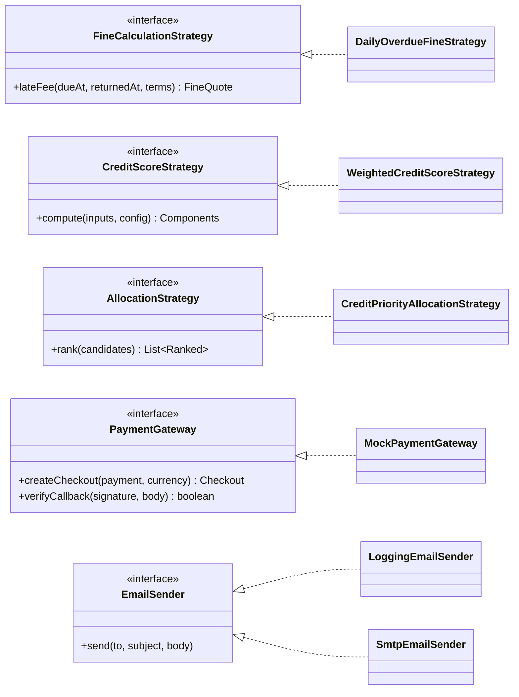

## 9. Data integrity and concurrency

A booking system is only useful if it never promises the same item twice, so we spent a fair amount of effort here.

- **Double bookings are impossible at the database level.** A PostgreSQL `EXCLUDE` constraint (using `btree_gist`) rejects any two `APPROVED` reservations for the same item whose time ranges overlap. Even a bug in the service layer could not create a double booking.
- **Row locks on critical actions.** Approvals, issues and extensions lock the equipment row and re-read it before deciding. Entities also carry a `@Version` column for optimistic locking.
- **Policy snapshots** on each loan, as described in the data model section.
- **Idempotent charges and payments.** Every fine has a dedupe key, so a job that runs twice cannot charge twice, and a payment that is already settled ignores repeated webhook calls.
- **Secure sessions.** Refresh tokens are opaque, stored only as hashes and rotated on every use. If an old refresh token is ever reused, all of that user's sessions are revoked, since reuse usually means the token was stolen.
- **Audit trail.** Approvals, overrides, waivers, payment verifications and role changes are all written to an audit log that administrators can search.
- **Testable time.** All time-dependent logic uses an injected `Clock`. The tests move this clock forward to simulate due dates, grace periods and overdue days without waiting.

## 10. Testing

The backend test suite in `backend/src/test` has two levels.

**Unit tests** cover the pieces that are pure logic: the reservation and loan state machines, the fine strategy (grace periods, rounding up to whole days, caps), the weighted credit score strategy and the allocation ranking.

**Integration tests** start the full Spring context against an in-memory H2 database in PostgreSQL compatibility mode, with a controllable clock. They walk through realistic scenarios end to end: competing requests and allocation, waitlist promotion, fines and partial payments, extensions, score changes and disputes, and the security rules that stop a student from seeing another student's data or a staff member from acting outside their labs.

```bash
cd backend
mvn test
```

The frontend is checked by building it (`npm run build`) and by clicking through the pages against the seeded demo data before each pull request.

## 11. Running the project

### 11.1 With Docker Compose (recommended)

You only need Docker. From the repository root:

```bash
cp .env.example .env        # optional; every value has a development default
docker compose up --build
```

| Service | Address |
|---|---|
| Web application | http://localhost:3000 |
| REST API | http://localhost:8080/api |
| Swagger UI | http://localhost:8080/swagger-ui.html (also at http://localhost:3000/swagger-ui.html) |
| Health check | http://localhost:8080/actuator/health |

On first start against an empty database, Flyway creates the schema and the seeder adds demo equipment, users and history. Set `SEED_DEMO_DATA=false` to start with only the administrator account, the default policy and the scoring configuration.

### 11.2 Local development without Docker

You need Java 21, Maven 3.9 or newer, Node 20 or newer and PostgreSQL 16.

```bash
# 1. Database
createuser -P campus            # password: campus
createdb -O campus campus_equipment

# 2. Backend on port 8080
cd backend
mvn spring-boot:run

# 3. Frontend on port 5173 (proxies /api to port 8080)
cd frontend
npm install
npm run dev
```

### 11.3 Demo accounts

| Role | Email | Password | Notes |
|---|---|---|---|
| Admin | admin@campus.edu | Admin12345 | Can be changed with `ADMIN_EMAIL` / `ADMIN_PASSWORD` |
| Lab staff | staff.lab@campus.edu | Staff12345 | CSE and EEE labs, all staff permissions |
| Lab staff | staff.media@campus.edu | Staff12345 | Media Lab, can verify payments and assess charges |
| Student | alice@student.campus.edu | Student123 | Clean borrowing history |
| Student | bilal@student.campus.edu | Student123 | One late return with a paid fine |
| Student | chen@student.campus.edu | Student123 | New student, neutral score |
| Student | daniela@student.campus.edu | Student123 | New student, neutral score |

The sign-in page also has one-click buttons for these accounts.

### 11.4 Configuration

All settings are read from environment variables; see `.env.example` and `backend/src/main/resources/application.yml`.

| Variable | Default | Purpose |
|---|---|---|
| `DB_URL`, `DB_USERNAME`, `DB_PASSWORD` | local PostgreSQL, `campus` / `campus` | Database connection |
| `JWT_SECRET` | development value | HMAC signing key of at least 32 bytes. **Change this in production.** |
| `JWT_ACCESS_TTL`, `JWT_REFRESH_TTL` | `PT15M`, `P7D` | Token lifetimes |
| `CAMPUS_TIMEZONE` | `UTC` | Time zone for notifications, reports and the nightly job |
| `MAIL_PROVIDER` | `log` | `log` prints emails to the backend log; `smtp` sends them using the `SMTP_*` settings |
| `PAYMENT_PROVIDER` | `mock` | Online payment adapter |
| `PAYMENT_WEBHOOK_SECRET` | development value | Shared secret expected in the `X-Webhook-Secret` header of payment webhooks |
| `PAYMENT_CURRENCY` | `USD` | Currency label for fines and payments |
| `JOBS_ENABLED` | `true` | Turns the scheduled jobs on or off |
| `SEED_DEMO_DATA` | `true` | Seeds demo data into an empty database |

## 12. API overview

The complete, interactive reference is available in Swagger UI once the backend is running. In outline:

| Area | Base path | Who may call it |
|---|---|---|
| Authentication | `/api/auth` (register, login, refresh, logout, me) | Anyone, or a signed-in user |
| Catalogue | `/api/equipment`, `/api/categories`, `/api/locations` | Any signed-in user |
| Student | `/api/me`, `/api/reservations`, `/api/loans`, `/api/fines`, `/api/payments`, `/api/credit`, `/api/disputes`, `/api/notifications`, `/api/dashboard/student` | Students (notifications and profile for every signed-in user) |
| Staff | `/api/staff/...` (requests queue, approvals, issue, returns, charges, extensions, payment verification, maintenance) | Staff and admins, limited to their labs and permissions |
| Admin | `/api/admin/...` (users, inventory, policies, credit configuration, fines, disputes, reports, audit) | Admins |
| Webhooks | `/api/payments/webhook/{provider}` | The payment provider, authenticated by shared secret |

Errors always come back in the same shape, `{timestamp, status, code, message, fields}`, so the frontend can show them consistently.

## 13. Team and contributions

This project was developed by a team of three as part of our software lab course. We split the work by area so that each member owned a clear part of the codebase, and every change reached `main` through a reviewed pull request.

| Member | Main responsibilities |
|---|---|
| [@shadowfax-505](https://github.com/shadowfax-505) (team lead) | Domain model and database schema, security, business services and REST API; the frontend shell (sign-in, layout, shared components, routing); Docker setup and documentation; reviewing and merging pull requests |
| [@Fatehkabir](https://github.com/Fatehkabir) | Student portal and staff portal |
| [@britto007](https://github.com/britto007) | Administrator portal and the backend test suite |

The detailed ownership of files and our branching workflow are described in [TEAM.md](TEAM.md).

## 14. Limitations and future work

There are several things we would like to improve with more time.

- **Real payment integration.** Payments currently go through a mock gateway. Connecting a real provider would mean writing one adapter class and its webhook signature check.
- **Campus single sign-on.** Students currently register with an email and password. Integrating the university's identity provider would remove the need for separate accounts.
- **Richer notifications.** Email is supported, but push or SMS reminders before a due time would probably reduce late returns further.
- **Score fairness review.** The weights were chosen by discussion within the team. With real usage data it would be worth checking whether the score treats occasional and frequent borrowers equally.
- **Frontend tests.** The backend is covered by automated tests, but the frontend is still checked by hand. Component tests and a few end-to-end browser tests would make changes safer.
